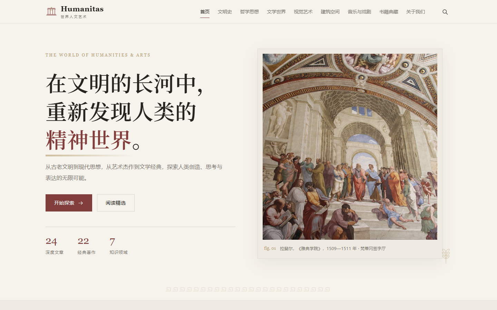
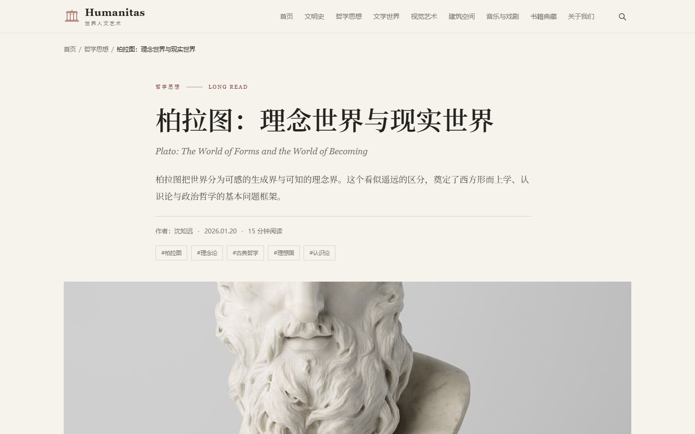
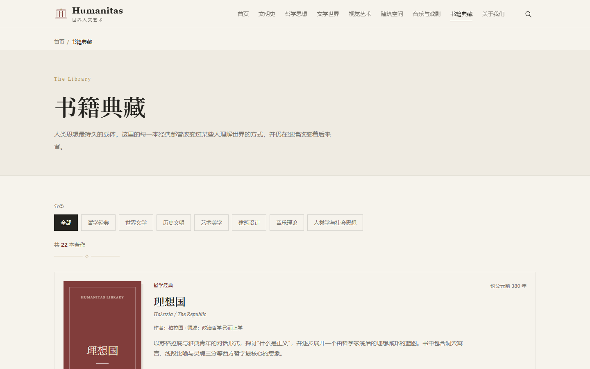
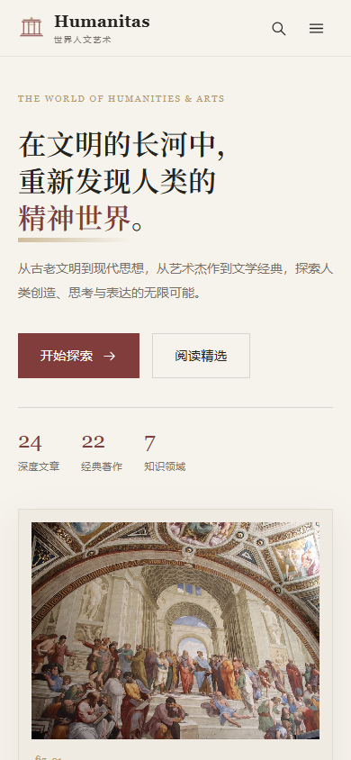

# Humanitas · 世界人文艺术

**World Humanities & Arts**

以人文理解世界，以艺术感知文明，以思想连接历史。

Humanitas 是一个中文世界人文艺术知识平台，融合数字博物馆、文化百科全书与深度阅读杂志的气质。网站以编辑式设计与克制的视觉语言，呈现世界文明、哲学思想、文学、艺术、建筑、音乐与经典著作的系统性内容。

---

## 一、网站定位

这不是一个普通博客，而是一个具有数字博物馆与学术出版物气质的内容平台：

- **数字博物馆**：本地化的高质量历史图像、艺术作品图像与完整的来源/授权记录
- **文化百科全书**：七大门类、层级清晰的知识体系与交叉检索
- **深度阅读杂志**：长篇文章具备引言、历史背景、发展脉络、人物、作品、分析、比较、影响与当代意义等完整结构

首批内容包含 **24 篇深度中文文章** 与 **22 本经典著作**，所有内容均为原创撰写，非占位文本。

---

## 二、主要功能

- 独立设计的首页：大型编辑式 Hero、编辑精选、文明图谱、思想者、艺术长廊、文学与经典、建筑、音乐、书籍推荐、本期专题
- 完整的分类页面：文明史、哲学思想、文学世界、视觉艺术、建筑空间、音乐与戏剧
- 文章详情页：目录锚点跳转、滚动章节高亮、引用块、图片说明、相关人物与作品、延伸阅读、参考文献、上一篇/下一篇
- 书籍典藏：分类筛选、可展开的完整书目信息（简介、核心思想、推荐理由、相关人物、延伸阅读）
- 全站搜索：同时检索文章、人物、书籍与专题，支持类型筛选
- 文章列表：领域筛选 + 标签筛选
- 面包屑导航、返回顶部、阅读进度条、移动端汉堡菜单
- 语义化 HTML、独立页面标题、meta description、Open Graph、sitemap.xml、robots.txt、favicon
- 响应式布局，适配 375px 至 1920px
- `prefers-reduced-motion` 支持，尊重用户的动画偏好

---

## 三、技术栈

| 层次 | 技术 |
| --- | --- |
| 构建工具 | Vite 6 |
| UI 框架 | React 18 |
| 语言 | TypeScript 5（严格模式） |
| 路由 | react-router-dom 6，**HashRouter** |
| 样式 | 原生 CSS（无 UI 组件库、无 CSS 框架） |
| 图形 | 原生 SVG 组件，无图标库 |
| 内容管理 | 本地 TypeScript 结构化数据 |
| 部署 | GitHub Pages + GitHub Actions |

**主要依赖**：`react`、`react-dom`、`react-router-dom`
**开发依赖**：`vite`、`@vitejs/plugin-react`、`typescript`、`@types/react`、`@types/react-dom`、`@types/node`

没有引入大型 UI 框架、动画库、数据请求库、后端服务或数据库。所有内容在构建时打包为静态资源。

### 为何使用 HashRouter

GitHub Pages 项目站点是纯静态托管，无法将任意路径回退到 `index.html`。HashRouter 把路由放在 URL 的 `#` 之后，因此刷新 `/#/articles/plato` 等任意页面都不会出现 404。

---

## 四、网站截图

以下截图均由 Playwright 在本地运行生产预览服务后真实截取，保存于 `docs/screenshots/`。

### 首页（桌面 1440 × 900）



### 文章详情页（1440 × 900）



### 书籍典藏页（1440 × 900）



### 移动端首页（390 × 844）



---

## 五、页面结构

| 路由 | 页面 |
| --- | --- |
| `/` | 首页 |
| `/civilizations` | 世界文明 |
| `/philosophy` | 哲学思想 |
| `/literature` | 文学世界 |
| `/art` | 视觉艺术 |
| `/architecture` | 建筑空间 |
| `/music` | 音乐与戏剧 |
| `/books` | 书籍典藏 |
| `/articles` | 文章列表（含筛选） |
| `/articles/:slug` | 文章详情（24 篇均可访问） |
| `/about` | 关于 Humanitas |
| `/search` | 全站搜索 |

---

## 六、项目目录结构

```text
humanitas/
├── public/
│   ├── favicon.svg
│   ├── robots.txt
│   ├── sitemap.xml
│   └── images/               # 49 张本地图片（按分类分子目录）
│       ├── hero/
│       ├── civilizations/
│       ├── philosophy/
│       ├── literature/
│       ├── art/
│       ├── architecture/
│       └── music/
├── src/
│   ├── assets/
│   │   └── svg/index.tsx     # 原创 SVG 装饰系统（品牌标记、柱式、图标、纹样等）
│   ├── components/           # Header、Footer、卡片、面包屑、滚动 UI、图片容错
│   ├── content/
│   │   ├── articles/         # 24 篇文章（按领域分 5 个文件 + index）
│   │   └── books/index.ts    # 22 本经典著作
│   ├── data/                 # 导航、分类元信息、首页专题数据
│   ├── pages/                # 12 个页面组件
│   ├── styles/               # global / layout / components / pages / responsive
│   ├── types.ts
│   ├── utils/                # 资源路径、页面 meta
│   ├── App.tsx
│   └── main.tsx
├── docs/screenshots/         # 真实网站截图
├── .github/workflows/deploy.yml
├── image-sources.md          # 图片来源与许可证记录
├── index.html
├── package.json
├── tsconfig.json
├── vite.config.ts
└── README.md
```

---

## 七、本地运行

### 环境要求

- Node.js 18 或更高版本（推荐 20 LTS）
- npm 9 或更高版本

### 安装依赖

```bash
npm install
```

### 开发模式

```bash
npm run dev
```

Vite 会输出本地地址。由于 `vite.config.ts` 设置了 `base: '/humanitas/'`，访问时请使用带前缀的地址，例如：

```text
http://localhost:5173/humanitas/
```

### 生产构建

```bash
npm run build
```

构建产物位于 `dist/`，包含全部 HTML、CSS、JS 与本地图片。

### 本地预览生产构建

```bash
npm run preview
```

预览地址同样带 `/humanitas/` 前缀，例如 `http://localhost:4173/humanitas/`。

### 类型检查

```bash
npm run typecheck
```

---

## 八、GitHub Pages 部署

### 1. 调整 base 路径

`vite.config.ts` 中：

```ts
export default defineConfig({
  base: '/humanitas/',
  // ...
})
```

如果 GitHub 仓库名不是 `humanitas`，请把 `/humanitas/` 改为 `/<你的仓库名>/`。本仓库的部署地址为 `https://yuxinrun.github.io/humanitas/`。

### 2. 开启 GitHub Pages

进入仓库 **Settings → Pages**，将 **Build and deployment → Source** 设为 **GitHub Actions**。

### 3. 推送代码

`.github/workflows/deploy.yml` 会在推送到 `main` 或 `master` 分支时自动执行：

1. `actions/checkout@v4` 拉取代码
2. `actions/setup-node@v4` 安装 Node 20 并缓存 npm
3. `npm ci` 安装依赖
4. `npm run build` 构建
5. `actions/upload-pages-artifact@v3` 上传 `dist/`
6. `actions/deploy-pages@v4` 部署到 GitHub Pages

也可以在 Actions 页面手动点击 **Run workflow** 触发部署。

### 4. 路由 404 说明

网站使用 HashRouter，所有路由形如 `/#/articles/plato`。静态服务器只需返回根目录的 `index.html`，浏览器端的 HashRouter 负责渲染对应页面，因此刷新任意页面都不会 404。

---

## 九、图片资源与版权

- 所有图片均已下载至 `public/images/`，运行时**不请求任何远程图片服务**。
- 图片主要从 Wikimedia Commons 公开 API 获取，优先选择公有领域（Public Domain）或 CC0 / CC BY / CC BY-SA 授权的作品。
- 每张图片的本地路径、原始文件名、作者、许可协议与来源页面都记录在 **[image-sources.md](image-sources.md)** 中。
- 图片统一压缩为渐进式 JPEG，最大宽度 1280px，质量 82，以兼顾画质与加载速度；所有 `` 均使用 `loading="lazy"`（Hero 等关键图除外）。
- 若某张图片无法可靠获取，页面会由自制 SVG 插画优雅降级，不会显示破图；缺失项会在 `image-sources.md` 中如实记录。
- 品牌标记、装饰纹样、古典柱式、建筑轮廓、分类图标、时间轴节点等均为本项目用原生 SVG 自主绘制，位于 `src/assets/svg/index.tsx`。

使用本站图片时，请遵守对应来源页面的许可要求（署名、相同方式共享等）。

---

## 十、内容维护

### 新增文章

1. 按领域选择文件：`src/content/articles/civilizations.ts`、`philosophy.ts`、`art.ts`、`literature.ts`、`heritage.ts`。
2. 复制一个对象，填入 `slug`、`title`、`titleEn`、`excerpt`、`author`、`date`、`readingTime`、`cover`、`coverAlt`、`tags` 等字段。
3. `sections` 是正文数组，每项包含 `id`（用于目录锚点，须在本文内唯一）、`title` 和 `paragraphs`；可选 `bullets`、`quote`、`image`。
4. `figures`、`works`、`furtherReading`、`references` 分别对应相关人物、代表作品、延伸阅读与参考资料。
5. 把文章封面图放到 `public/images/` 对应目录，并在 `image-sources.md` 中补充来源。
6. 如果希望文章出现在首页「编辑精选」，将 `featured` 设为 `true`。
7. 在 `public/sitemap.xml` 中增加新文章的 URL。
8. 运行 `npm run build` 验证。

### 新增书籍

1. 打开 `src/content/books/index.ts`，在 `books` 数组中加入一个对象。
2. 填写 `id`、`title`、`originalTitle`、`author`、`year`、`category`、`field`、`summary`、`ideas`（核心思想数组）、`reason`、`figures`、`furtherReading`。
3. `category` 应是 `bookCategories` 中已有的分类，或同时向该数组添加新分类。
4. 书籍封面由 CSS 根据书名与作者自动生成，无需额外图片。
5. 请核对出版年份与原文书名，避免虚构信息。

### 内容写作规范

- 避免虚构历史事实、名言与出版信息；不确定的说法用「据……记载」「通说认为」等表述。
- 不同文章不得复用相同段落模板；每篇都应有独特的分析角度。
- 引用请注明出处，并在 `references` 中列出可查证的文献。

---

## 十一、后续规划

- 增加更多文明专题，如美索不达米亚、波斯、伊斯兰黄金时代的独立长文
- 为书籍条目增加独立详情页与跨书关联
- 引入深色阅读模式（可选功能）
- 增加时间轴交互式浏览视图
- 补充更多自制 SVG 插画，覆盖全部缺失素材
- 建立内容贡献指南与审校流程

---

## 十二、验收状态

- 页面：12 个路由页面全部实现并可访问
- 文章：24 篇深度中文文章
- 书籍：22 本经典著作
- 本地图片：49 张（已压缩）
- SVG：原创图形组件 1 套，含品牌标记、柱式、建筑轮廓、纹样、时间轴节点、分类图标等
- 构建：`npm run build` 成功
- 控制台：Playwright 检查 0 错误、0 警告
- 截图：4 张真实截图（桌面首页、文章详情、书籍典藏、移动端首页）
